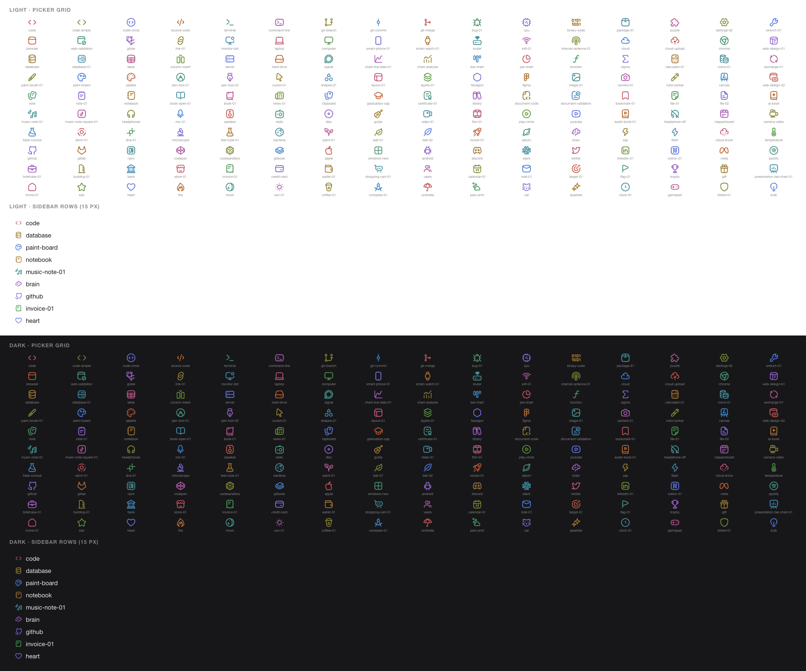

# dsh-workspace-icons

中文 · [English](./README.md)

给 DSH Web 侧栏里的每个项目文件夹（workspace）设一个图标——内置 160 个 Hugeicons 图标（每个都有自己的颜色），也可以用 emoji 或图片。没有手动设置的项目，插件会**读一遍项目内容、让 AI 从图标库里挑一个**并给出理由，模型不可用时用本地规则兜底。

## 安装

```bash
dsh plugin --profile <profile> add dsh-workspace-icons
```

`<profile>` 是你运行 Harness 用的 profile（桌面版是 `desktop`）。这条命令把包装进该 profile 的 `dependencies`、把 `dsh-workspace-icons` 追加到 `dsh.profile.bundles`（bundle 补丁靠这条插入 Host 行），再由 pnpm 建好依赖链接。

装完重启 Harness，让 Host 半加载。之后应该能：设置里多出「项目图标」一页，侧栏项目行右键能弹出选择器。

## 预览




两张图都是**插件自己生成的结果**（颜色来自 `glyphColor()`，项目行由 `buildCss()` 输出套在假数据上渲染），不是 Harness 窗口的截图。

## 使用

有两种入口，操作的是同一份数据：

1. **右键项目行**（推荐）——在侧栏任意项目标题行上点右键，弹出图标选择器，选图标 / 输入自定义 emoji / 填图片地址，即时生效。有 AI 建议时会先显示一行「AI 建议 · 理由」，可以一键采用或重新识别。
2. **设置 → 项目图标**——列出全部项目，逐个设置或清除；顶部有「自动为项目挑选图标」开关和「全部重新识别」按钮。

选择器里有三个页签：

- **图标**（默认）——160 个内置 [Hugeicons](https://hugeicons.com) 图标（免费版 stroke-rounded 风格），分 10 类（代码 / 网络 / 数据 / 设计 / 文档 / 媒体 / 科学 / 品牌 / 业务 / 生活），带搜索框；**每个图标都有自己的颜色**（见下方「图标颜色」）；
- **Emoji**——7 组调色板（共 60+ 个）加一格自定义粘贴任意单个 emoji；
- **图片**——`https://…` 与 `data:image/…`（`javascript:`、`file:` 一律拒绝）。

还有「移除图标」，把该项目恢复成默认文件夹图标。

### 图标颜色

160 个预设图标各有一个专属颜色，按图标在图标表里的位置算出来（黄金角散开色相），不是随机分配：同一个图标永远是同一个颜色，挑过一次就认得住。颜色在 OKLCH 空间里生成、再转成 sRGB 十六进制写进样式表，所以亮度齐平——黄和蓝看起来一样清楚，不会出现「黄色糊在白底、蓝色暗在深色底」；对比度落在浅色主题 3.7–4.3:1、深色主题 4.1–4.9:1，两种主题都看得清。emoji 和图片图标不受影响（emoji 用它自己的颜色，图片用原图）。

## AI 自动识别

默认开启。规则很简单：

- 只处理**既没有手动图标、也还没有建议**的项目；
- 同一个项目 10 分钟内最多分析一次；一次失败后 2 分钟内不再重试；
- 一次只发一个请求，Host 侧最多 2 个项目并行，单项目 25 秒、整批 45 秒超时；
- 手动图标**永远优先**；删掉手动图标后，之前那条 AI 建议会重新生效。

Host 侧读的证据（都在项目根目录，不会递归整个仓库）：

| 来源 | 取什么 |
| --- | --- |
| `package.json` | `name` / `description` / `keywords` / `dependencies` / `scripts` |
| 其它清单 | `pyproject.toml`、`requirements.txt`、`Cargo.toml`、`go.mod`、`Gemfile`、`pom.xml`、`build.gradle(.kts)`、`composer.json`、`Package.swift`、`pubspec.yaml`、`CMakeLists.txt`、`*.uproject`（各取开头 1.4 KB） |
| `README*` | 开头 900 字 |
| 顶层条目 | 最多 40 个（跳过 `node_modules`、`.git`、`dist`、`target`、`.venv` 等，也跳过点文件） |
| 语言分布 | 顶层文件 + 最多 6 个子目录各一层，按扩展名归桶 |

模型按「这个项目**是什么**」而不是「用了什么技术」挑一个图标，只允许回一个 JSON：`{"glyph":"<名字>","why":"<理由>"}`，`glyph` 必须精确命中图标名，理由一句话、跟着界面语言（中文或英文）。任何一步失败（没有模型、超时、输出非法）都退回**本地规则**——依赖表 → README/名字关键词 → 主导语言 → 清单类型 → 通用文件夹图标，所以离线也有结果，且结果永远在 160 个图标之内。

代价与边界：项目路径、名称和上面那些证据片段会发给你在 DSH 里配置的默认模型（`agentDefaultModel`）；不发文件全文、不发代码内容、不写任何项目文件。不想用就在设置页关掉开关，之后不会再发请求（已存下的建议仍会继续显示，可逐个覆盖或清除）。

## 数据存在哪

两种状态都只存在**浏览器 localStorage**，按**项目文件夹路径**索引（没有路径时退回 workspace id），所以重命名项目不会丢：

- `dsh-workspace-icons.v1` —— 手动图标；
- `dsh-workspace-icons.auto.v1` —— AI/规则建议（含理由、来源、时间戳）与自动识别开关。

每种最多保留 500 条，超出后丢弃最早记录的项目，避免长期使用把 localStorage 越攒越大。不写任何文件、不同步到其它设备；清除浏览器数据会一起消失。

## 实现说明

插件由两半组成：

**浏览器半（`client.js`）**挂两个官方插槽：

- `settings.section` —— 「项目图标」设置页（`order: 25`）；
- `shell.overlay` —— 右键选择器（`order: 40`，靠文档级 `contextmenu` 监听定位到项目行）。

两个插槽的标准 props 都带 `useWorkspaces`，所以项目列表不需要额外 IPC。图标绘制因为没有官方插槽，走的是**结构选择器**：

```css
[data-row-key="workspace:<id>"] > span:first-child > svg { display: none }      /* 藏掉原生文件夹图标 */
[data-row-key="workspace:<id>"] > span:first-child::before { … }                 /* 画上自己的 */
```

`data-row-key` 是侧栏行上稳定的语义属性，CSS 类名是 hash 过的所以不依赖它。

预设图标的颜色由 `glyphColor()` 在浏览器里算一次并缓存：`OKLCH(0.60, ≤0.17, 黄金角×序号)` → sRGB hex，再用 `background-color` 配合 mask 画出来；同一套颜色既给侧栏行，也给选择器和设置页里的预览小图标。

**Host 半（`index.js` + `lib/`）**只做一件浏览器做不到的事：读文件、调用模型。它注册一条需要登录态的 Host 路由：

```
POST /api/workspace-icons/suggest
{ "language": "zh" | "en", "projects": [{ "key": "...", "path": "/abs/path", "title": "..." }] }
→ { "results": [{ "key", "path", "glyph", "why": { "zh"?, "en"? }, "source": "ai" | "rule" }], "route": "<model>" }
```

- 只接受绝对路径，最多 24 个项目，key 去重，请求体上限 64 KB；
- 有 `workspaceRegistry` 服务时只读已登记为 workspace 的目录（否则返回 `422 unknown-workspace`）；
- 模型调用走 `ctx.get('llm').stream(...)`（`@deepseek-ai/dsh-llm` 的 `createUserMessage` + `BlockAssembler`），`maxTokens: 160`，带 `AbortSignal`；这个依赖是**惰性 import** 的，解析不到就只用本地规则，不会拖垮整个 bundle；
- 模型不可用 / 报错 / 超时 / 输出非法 → 那条结果 `source: "rule"`，永远有图标。

## 从 1.x 升级

1.x 用的是 Phosphor 图标名（`browser`、`sparkle`…），2.0 换成了 Hugeicons 的名字（`browser`、`sparkles`、`rocket-01`…），两套不通用。旧的 `kind: "glyph"` 条目在读取时通不过名字校验，会被静默丢弃，项目回到默认文件夹图标（或 AI 建议）；重新挑一次就好，localStorage 的 key 没变，emoji / 图片图标完全不受影响。

## 兼容性

- 在 DSH 0.2.2-rc.1 上开发与验证；需要提供 `connection` 服务（Host 路由）、`llm` 服务（AI 建议用，可选）以及 `settings.section` / `shell.overlay` 插槽的 Harness。Node 20+。
- 需要侧栏由 `@deepseek-ai/dsh-client-ui-workspace` 提供（当前实现）；`workspace-tree` 分组模式用的是同一套 `workspace:<workspaceId>` 行 key，图标照常显示，只有 `flat` 模式没有项目行、无处可画。
- 如果未来 DSH 改掉项目行的 DOM（`data-row-key` 或首个子元素的结构），图标绘制会**静默失效**：副作用只是图标不再显示，设置页照常可用、不报错、不影响其它任何功能。升级 DSH 后如果发现图标没了，看一眼 `client.js` 里的 `buildCss()` 与 `ROW_PREFIX` 即可定位。
- AI 建议依赖 profile 配置的默认模型；换模型 / 换 provider 后下一次识别就用新的。

## 开发

```bash
npm run check          # 语法 + 图标表新鲜度 + 三套测试
npm test               # 只跑测试
npm run test:analyze   # 只跑证据读取与兜底规则（纯函数，临时目录当夹具）
npm run test:host      # 只跑 Host 路由（伪 Cordis context + 伪模型）
```

图标表是**生成代码**（`client.js` 里 `#region hugeicons-glyphs` 之间的部分），不要手改。要增删/换图标：改 `scripts/build-glyphs.mjs` 里的 `GROUPS` 列表（写 Hugeicons 的导出名，比如 `CodeSimpleIcon`），准备一次素材再生成：

```bash
npm pack @hugeicons/core-free-icons --pack-destination /tmp/hugeicons
mkdir -p /tmp/hugeicons && tar -xzf /tmp/hugeicons/hugeicons-core-free-icons-*.tgz -C /tmp/hugeicons
npm run build:glyphs      # 默认从 /tmp/hugeicons/package/dist/esm 读，可用 --source 指定
npm run build:glyphs -- --names   # 只重写 lib/glyphs.mjs（Host 半用的名字表），不需要素材
```

生成后的 id 是导出名去掉 `Icon` 再转 kebab-case：`CodeSimpleIcon` → `code-simple`、`Bug01Icon` → `bug-01`。

`npm run check:glyphs` 只校验不写（CI 用），也不需要素材。

测试覆盖：两个插槽的注册参数、生成的 CSS（隐藏原生图标 / Hugeicons 图标 / emoji / 图片四种形态）、localStorage 往返与损坏数据容错、存储上限、三种图标校验、右键行为（会话行不误触）、建议合并（手动优先）、请求去重与失败退避、图标表完整性、zh/en 字典键一致性；证据读取（清单 / README / 目录 / 语言分布 / 缺失目录容错）、兜底规则（Next.js→browser、torch→brain、Rust→settings-02、空目录→package-01、「language model」不被当成 3D）、prompt 结构与 JSON 解析；Host 路由（注册参数、坏 JSON 400、相对路径拒绝、超大请求体 413、未登记的 workspace 422、规则兜底、模型成功/非法/抛错/超时、没有默认模型、dispose 摘除路由）。

目录：

```
client.js                    浏览器半（UI + 生成的图标表 + 建议状态机）
index.js                     Host 半（/api 路由、证据读取、模型调用、兜底）
lib/analyze.js               证据读取与本地规则（纯函数，可单独测）
lib/glyphs.mjs               160 个图标名（生成，Host 半引用）
cordis.patch.yml             bundle 补丁：insert workspace-icons
locale/{zh,en}.json          文案
icon.svg                     插件图标
scripts/build-glyphs.mjs     图标表生成器（client.js 区块 + lib/glyphs.mjs）
THIRD-PARTY-NOTICES.md       Hugeicons 的 MIT 许可
test/contract.test.mjs       浏览器半契约测试
test/analyze.test.mjs        证据与兜底规则测试
test/host.test.mjs           Host 路由测试
```

## 卸载

```bash
dsh plugin --profile <profile> remove dsh-workspace-icons
```

然后确认 `~/.dsh/profiles/<profile>/package.json` 的 `dsh.profile.bundles` 里没有残留条目（有就删掉），重启 DSH。卸载不会清理 localStorage，想彻底清干净在浏览器控制台执行：

```js
localStorage.removeItem('dsh-workspace-icons.v1')
localStorage.removeItem('dsh-workspace-icons.auto.v1')
```

## 许可

MIT，见 [LICENSE](./LICENSE)。内置图标来自 Hugeicons 免费版（MIT），许可见 [THIRD-PARTY-NOTICES.md](./THIRD-PARTY-NOTICES.md)。
